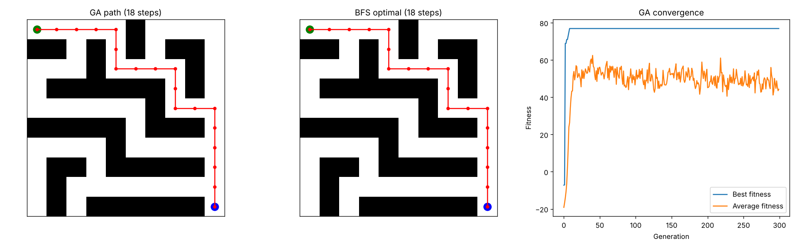

# GA Maze Path Planner (WingMan / NIDAR – GA module)

A Genetic Algorithm evolves a sequence of moves (U/D/L/R) that guides a drone from start to goal
through a grid maze with obstacles, compared against BFS (optimal baseline).

## How it works
- Chromosome: 60 moves (0=U, 1=D, 2=L, 3=R)
- Fitness: -Manhattan distance to goal, small penalty for revisits, big bonus for reaching the goal (shorter = better)
- Selection: tournament (k=5) + 4 elites; single-point crossover; 5% mutation
- Population 200, 300 generations

## Run
    pip install numpy matplotlib
    python ga_maze.py

## Result (seed 42)
GA reached the goal in 18 steps, equal to the BFS optimal path (18).
